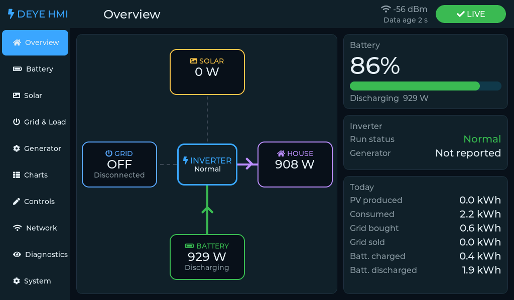
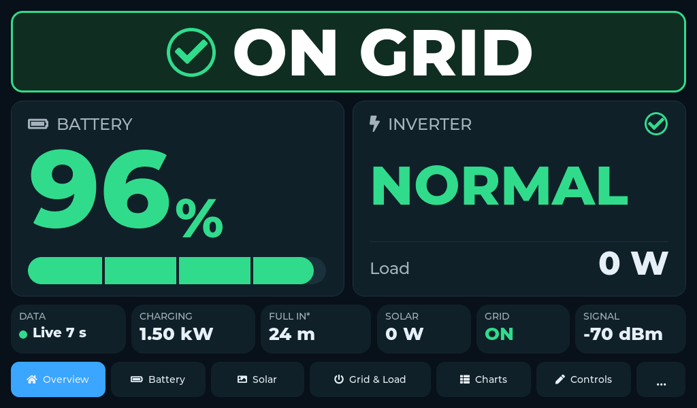
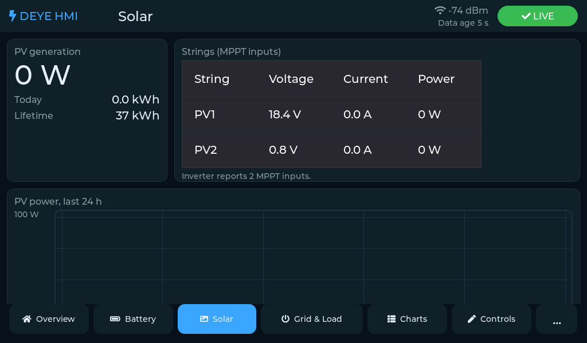
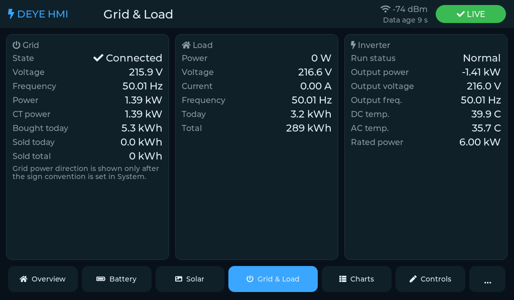

# Deye HMI

Touchscreen monitor for a Deye SUN-6K-SG05LP1-EU-AM2-P hybrid inverter on a
**Waveshare ESP32-S3-Touch-LCD-5B** (1024x600). The display reads telemetry
over Wi-Fi from the existing Prometheus exporter on the Raspberry Pi; it never
talks Modbus itself.

> Status 0.1.0: built, flashed and running on the 5B board. Automatic Wi-Fi,
> saved network settings, live telemetry and device screenshots are verified.
> Inverter writes are **disabled**: the write API contract is unavailable.

## Real device screenshots

These images were captured on the ESP32 itself while reading the real exporter.
They are not desktop renders or demo values. Both Overview states were
captured after flashing the new layout on 2026-11-21.

| On battery | On grid |
|---|---|
|  |  |

The remaining captures below show the detailed screens from 2026-11-20;
they are still useful as detailed views of the same telemetry.

| Battery | Solar |
|---|---|
|  |  |

| Grid and load | History |
|---|---|
|  |  |

## Features

* Glanceable Overview with state headline, large battery and inverter cards,
  and live data, power, runtime, grid and signal tiles
* Runtime and time-to-full estimates based on 15 kWh combined battery capacity
  and a 20% discharge cutoff; see [estimate details](docs/runtime-estimate.md)
* Battery, Solar (per MPPT), Grid & Load, Generator, Charts (1 h - 7 d), Controls (read-only ToU), Network, Diagnostics, System
* Live / stale / offline indication with data age; unknown values shown as `--`
* On-screen Wi-Fi setup, NVS settings, optional settings PIN, screen timeout
* File-based network provisioning, DHCP or static IPv4, DNS and NTP
* Live BMP screenshots and health metrics over the trusted LAN
* HTTPS OTA with automatic rollback
* Control safety layer (validation, confirmation, cooldown, read-back, UNCERTAIN handling) - tested, writes disabled

## Quick start

```bash
cp config/network.example.h config/network.local.h
# Edit SSID, password and exporter host in config/network.local.h.
scripts/idf.sh set-target esp32s3 && scripts/idf.sh build   # Docker, ESP-IDF 5.5.1
cd build
uvx --from esptool==4.9.0 esptool.py --chip esp32s3 --port PORT --baud 460800 \
  --before default_reset --after hard_reset write_flash @flash_args
```

The profile is saved to NVS at boot and the display connects automatically.
The local file and provisioned binaries contain your password and are excluded
from Git. See [network configuration](docs/network-config.md).

Alternatively, use Network on the touchscreen to configure Wi-Fi and the
exporter host/port. The exporter path is always `/metrics`.

Without the Pi: `cd backend/mock && uv run deye-mock --port 9101` and point
the device at your PC.

## Repository

| Path | Content |
|---|---|
| `main/` | boot sequence |
| `components/deye_core/` | portable parser, model, freshness, history, control safety (host-tested) |
| `components/app/` | settings, state, Wi-Fi, telemetry, OTA, diagnostics |
| `components/board/` | 5B display/touch/backlight |
| `components/ui/` | LVGL theme, widgets, screens |
| `backend/mock/` | mock exporter (Python, uv) |
| `tests/` | unit tests and real/derived fixtures |
| `scripts/` | build, format, analysis, packaging |
| `docs/` | architecture, API contract, safety, build/flash/release, test results |

## Documentation

[Engineering report and implementation status](docs/engineering-report.md).

[architecture](docs/architecture.md) - [API contract](docs/api-contract.md) -
[control safety](docs/control-safety.md) - [writable parameters](docs/writable-parameters.md) -
[build](docs/build.md) - [flashing](docs/flashing.md) - [release/OTA](docs/release.md) -
[network file](docs/network-config.md) - [screenshots](docs/screenshots.md) -
[troubleshooting](docs/troubleshooting.md) - [test results](docs/test-results.md) -
[hardware validation](docs/hardware-validation.md) -
[overview state flow](docs/diagrams/overview-state-flow.md) -
[navigation flow](docs/diagrams/navigation-flow.md)

## Known limitations

* Touch calibration, long-running stability, static IPv4 and OTA/rollback still need hardware validation.
* No inverter writes; no generator metrics; no BMS module data; no backend history (on-device history is lost on reboot).
* Grid power sign unverified; battery sign inferred from one sample.
* Plain HTTP, unauthenticated reads (exporter offers nothing else).
* PIN and Wi-Fi credentials stored in NVS without flash encryption.
* Screenshot diagnostics use unauthenticated HTTP; restrict them to a trusted LAN or disable `DEYE_SCREENSHOT_HTTP`.
* English UI only; Cyrillic needs a font build.

License: Apache-2.0 (see LICENSE, NOTICE). The Montserrat ExtraBold font is
licensed under SIL OFL 1.1 (see `components/ui/fonts/OFL.txt`).
