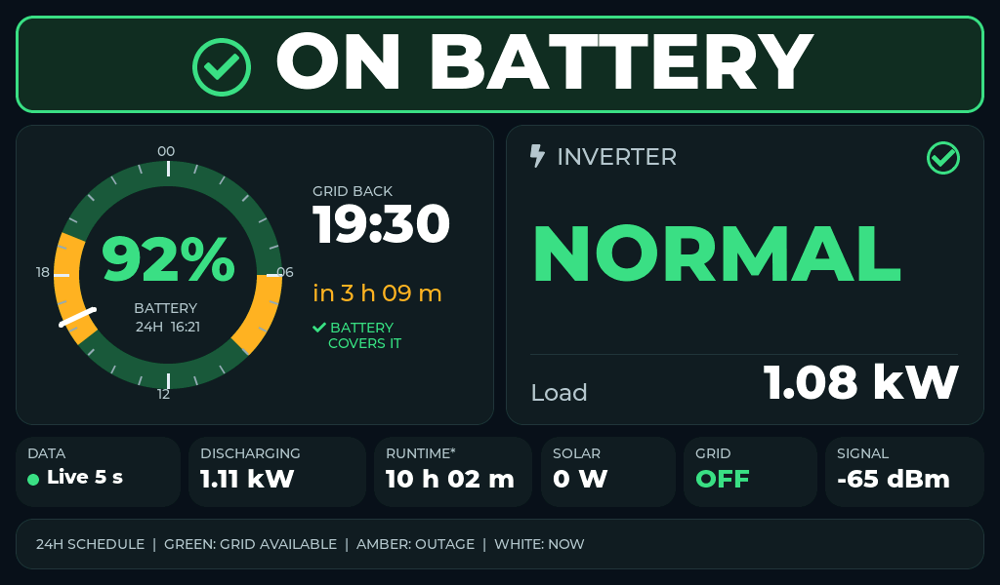
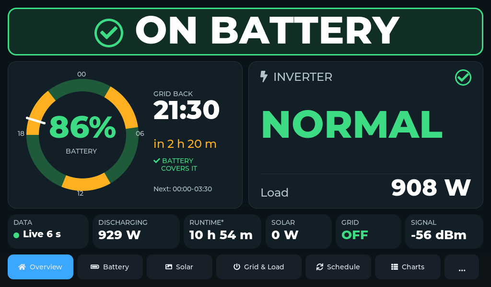
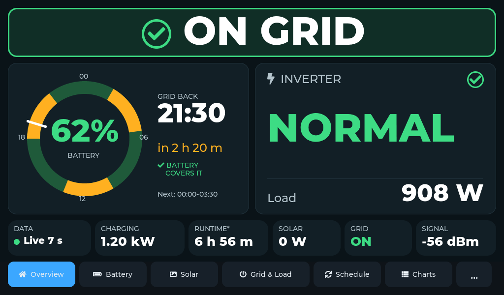
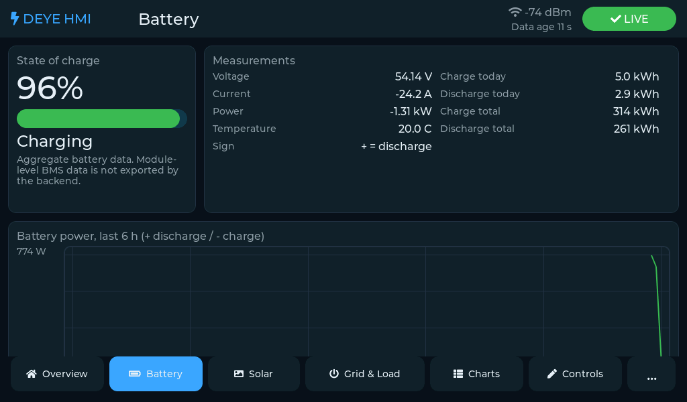
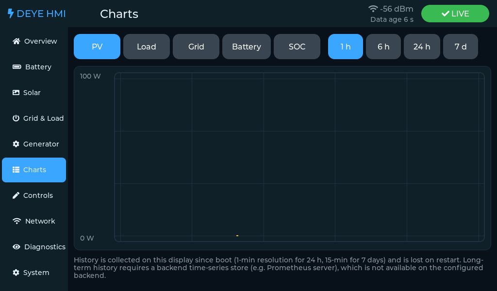

# Deye HMI

Touchscreen monitor for a Deye SUN-6K-SG05LP1-EU-AM2-P hybrid inverter on a
**Waveshare ESP32-S3-Touch-LCD-7B** (7-inch, 1024x600). The display reads telemetry
over Wi-Fi from the existing Prometheus exporter on the Raspberry Pi; it never
talks Modbus itself.

> The 7B Overview was flashed and captured on a physical board on 2026-11-22.
> Inverter writes are **disabled**: the write API contract is unavailable.

## Live 7B Overview



This is a capture from the running board. The dial shows the real confirmed
outage intervals for group 4.1 from the public
[Kyiv-region JSON](https://raw.githubusercontent.com/Baskerville42/outage-data-ua/main/data/kyiv-region.json).
The white hand marks the current local time; amber arcs mark scheduled outages.
The board downloads the JSON every 10 minutes and shows `SCHEDULE UNAVAILABLE`
if the source is missing or stale. Only Overview is built in the current UI.

## Earlier 7B host previews

These LVGL host renders use fixture data, not live schedule data.

| On battery | On grid |
|---|---|
|  |  |

Other preview states: [low battery](docs/screenshots/host-7b-warn.png),
[inverter fault](docs/screenshots/host-7b-fault.png),
[no data](docs/screenshots/host-7b-stale.png), and
[schedule unavailable](docs/screenshots/host-7b-schedule-unavailable.png).

## Previous 5B device screenshots

These images were captured on the previous 5B firmware while reading the real
exporter. They are retained as historical device evidence, not 7B screenshots.

| On battery | On grid |
|---|---|
|  |  |

The detailed screens below were recaptured on the 5B interface on 2026-11-21.

| Battery | Solar |
|---|---|
|  |  |

| Grid and load | History |
|---|---|
|  |  |

## Features

* Single-screen 24-hour outage dial Overview with hourly ticks, a white
  current-time hand, measured state headline, battery and inverter cards,
  six live detail tiles and a five-minute load average estimate
* Runtime estimate based on 15 kWh combined battery capacity and a 20% reserve
* Live / stale / offline indication with data age; unknown values shown as `--`
* File-based network provisioning, DHCP or static IPv4, DNS and NTP
* Live BMP Overview screenshots and health/schedule/memory metrics over the trusted LAN
* HTTPS OTA with automatic rollback

## Quick start

```bash
cp config/network.example.h config/network.local.h
# Edit SSID, password and exporter host in config/network.local.h.
scripts/idf.sh set-target esp32s3 && scripts/idf.sh build   # Docker, ESP-IDF 5.5.1
cd build
uvx --from esptool==4.9.0 esptool.py --chip esp32s3 --port PORT --baud 460800 \
  --before default_reset --after hard_reset write_flash @flash_args
```

The profile is saved to NVS at boot and the display connects automatically.
The local file and provisioned binaries contain your password and are excluded
from Git. See [network configuration](docs/network-config.md).

The current single-screen UI has no on-screen network settings. Configure the
network profile before building. The exporter path is always `/metrics`.

Without the Pi: `cd backend/mock && uv run deye-mock --port 9101` and point
the device at your PC.

## Repository

| Path | Content |
|---|---|
| `main/` | boot sequence |
| `components/deye_core/` | portable parser, model, freshness, history, control safety (host-tested) |
| `components/app/` | settings, state, Wi-Fi, telemetry, OTA, diagnostics |
| `components/board/` | 7B display/touch/backlight |
| `components/ui/` | LVGL theme, widgets, screens |
| `backend/mock/` | mock exporter (Python, uv) |
| `tests/` | unit tests and real/derived fixtures |
| `scripts/` | build, format, analysis, packaging |
| `docs/` | architecture, API contract, safety, build/flash/release, test results |

## Documentation

[Engineering report and implementation status](docs/engineering-report.md).

[architecture](docs/architecture.md) - [API contract](docs/api-contract.md) -
[control safety](docs/control-safety.md) - [writable parameters](docs/writable-parameters.md) -
[build](docs/build.md) - [flashing](docs/flashing.md) - [release/OTA](docs/release.md) -
[network file](docs/network-config.md) - [screenshots](docs/screenshots.md) -
[troubleshooting](docs/troubleshooting.md) - [test results](docs/test-results.md) -
[hardware validation](docs/hardware-validation.md) -
[overview state flow](docs/diagrams/overview-state-flow.md) -
[navigation flow](docs/diagrams/navigation-flow.md)

## Known limitations

* Long-running stability, static IPv4 and OTA/rollback still need hardware validation.
* No inverter writes; no generator metrics; no BMS module data; no backend history (on-device history is lost on reboot).
* Grid power sign unverified; battery sign inferred from one sample.
* Plain HTTP, unauthenticated reads (exporter offers nothing else).
* PIN and Wi-Fi credentials stored in NVS without flash encryption.
* Screenshot diagnostics use unauthenticated HTTP; restrict them to a trusted LAN or disable `DEYE_SCREENSHOT_HTTP`.
* English UI only; Cyrillic needs a font build.
* The outage source is a public third-party mirror, not an official DTEK API.
  Only confirmed intervals are shown, and the plan is rejected after 24 hours.
* Network and diagnostics settings pages are not available in the single-screen UI.
  OTA and screen settings cannot be started from the display in this layout.

License: Apache-2.0 (see LICENSE, NOTICE). The Montserrat ExtraBold font is
licensed under SIL OFL 1.1 (see `components/ui/fonts/OFL.txt`).
