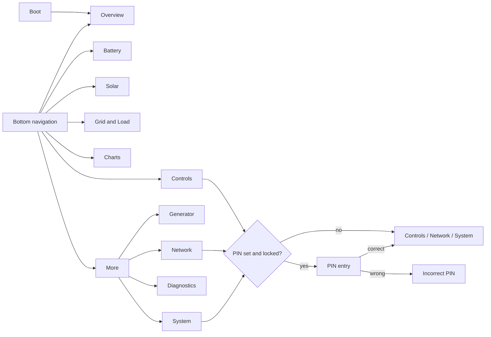

# Screen map

| # | Tab | PIN | Content | Data source |
|---|---|---|---|---|
| 1 | Overview | - | state headline, SOC, inverter/load, freshness, battery and solar power, grid, signal, runtime estimate | /metrics + settings |
| 2 | Battery | - | SOC bar, V/A/W/temp, daily/total energy, 6 h battery power chart | /metrics + history |
| 3 | Solar | - | total PV, per-MPPT string table (count from `deye_device_mppts`), 24 h PV chart | /metrics + history |
| 4 | Grid & Load | - | grid state/V/Hz/power/CT/energy, load, inverter output and temperatures | /metrics |
| 5 | Generator | - | "not reported by backend" measurements, generator charging flags per ToU slot | /metrics (ToU) |
| 6 | Charts | - | PV/Load/Grid/Battery/SOC x 1 h/6 h/24 h/7 d and today's energy totals | on-device history + /metrics |
| 7 | Controls | yes | read-only ToU table, candidate parameters with status, command status/acknowledge | /metrics + control.c |
| 8 | Network | yes | Wi-Fi status/scan/password, backend host/port/poll, test, latency, last error | settings + state |
| 9 | Diagnostics | - | firmware, heap/PSRAM, uptime, reset reason, poll counters, parser counters | diag + state |
| 10 | System | yes | theme, screen timeout, grid sign, language, PIN, OTA URL/install, restart, factory reset | settings |

Overlays: confirmation dialog (modal), text/number entry with keyboard,
info message box, wake overlay while the backlight is off (first touch only
wakes).

