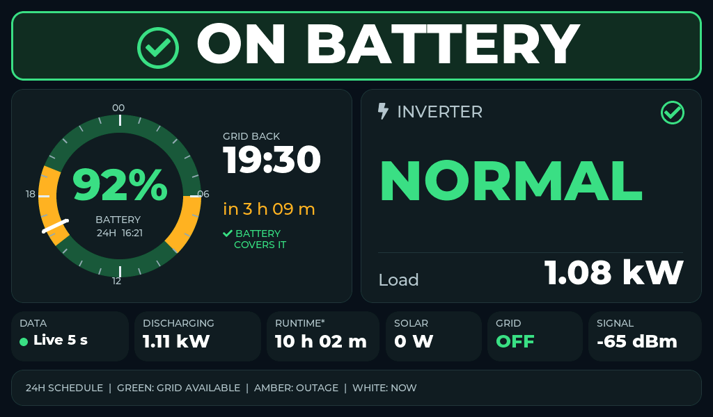

# Screenshots directly from the ESP32

When `CONFIG_DEYE_SCREENSHOT_HTTP=y`, the display exposes diagnostics on HTTP
port 80 after joining Wi-Fi:

| Request | Result |
|---|---|
| `GET /screenshot.bmp` | Current monitoring screen as RGB565 BMP |
| `GET /screenshot.bmp?screen=overview` | Select Overview and capture it |
| `GET /health` | Display HTTP service status |
| `GET /metrics` | Uptime, heap/PSRAM, clock and outage-fetch diagnostics |

Only `overview` is supported in the current single-screen firmware. Other
screen names and open modal dialogs are excluded.

```bash
curl --fail "http://<display-ip>/screenshot.bmp?screen=overview" -o overview.bmp
# macOS, optional PNG conversion
sips -s format png overview.bmp --out overview.png
```

The image is rendered by LVGL **on the running ESP32**, under its display lock,
using the actual application state. The capture waits for
the standard theme transition without holding the display lock. Network
transfer also runs after releasing that lock. Only one temporary RGB565 image
is allocated; no continuous capture loop runs.

The original captures in `docs/screenshots/` are from the previous 5B build
with live inverter telemetry. `overview.png` (on battery) was replaced on
2026-11-21 after flashing the new layout; `overview-grid.png` (on grid) was
captured later the same day. Battery, Solar, Grid & Load, and Charts were also
recaptured from the running device on 2026-11-21.
`overview-7b-live.png` is a physical 7B capture on 2026-11-22 with a fresh
group 4.1 schedule and measured inverter telemetry. `host-7b-*.png` are six
deterministic LVGL host renders with mock schedule and test telemetry;
`host-7b-schedule-unavailable.png` shows the unavailable-source fallback.



| State | Host render from the earlier navigation layout |
|---|---|
| On battery | [host-7b-ok.png](screenshots/host-7b-ok.png) |
| On grid | [host-7b-grid.png](screenshots/host-7b-grid.png) |
| Low battery | [host-7b-warn.png](screenshots/host-7b-warn.png) |
| Inverter fault | [host-7b-fault.png](screenshots/host-7b-fault.png) |
| No data | [host-7b-stale.png](screenshots/host-7b-stale.png) |
| Schedule unavailable | [host-7b-schedule-unavailable.png](screenshots/host-7b-schedule-unavailable.png) |

This service has no authentication or TLS. Use it on a trusted LAN only, or
disable *Deye HMI -> Enable LAN screenshots and display diagnostics*.
